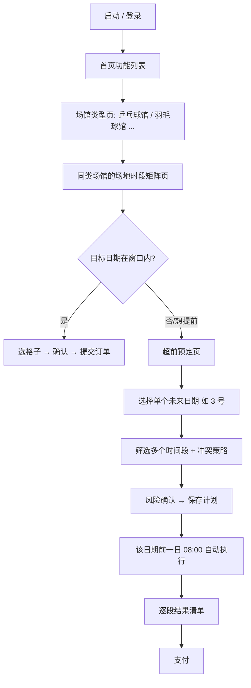

# Book

> 独立 App：登录后选择运动场馆，以表格直观展示全部场地×全部时段的预约状态；对尚未开放的日期，通过「超前预定」预先选定多个时间段，到开放时刻自动抢约。

## 1. 项目概览

本项目独立于现有 Hunau App，专注体育场馆预约。现有 Hunau App 中该功能只是 WebView 加载超星网页，用户需要手动逐级点选，看不到同一运动场馆下所有场地与时段的全貌，也无法提前布置抢约。

本项目把这条链路拆成两种使用方式：

- **当场预约**：在可预约窗口内，打开某类运动场馆（如羽毛球馆）即看到该场馆下全部场地与时段矩阵，点格子直接下单。
- **超前预定**：对可预约窗口之外的一个未来日期（如 3 号），预先选定多个时间段与冲突处理策略，到该日期开放的时刻自动执行。

## 2. 核心流程



## 3. 功能清单

| 编号 | 功能 | 说明 | 状态 |
| --- | --- | --- | --- |
| F-01 | 账号登录 | 学校账号密码登录，换取超星登录态并持久化 | 规划中 |
| F-02 | 功能入口 | 登录后展示功能列表，当前含「场馆预约」 | 规划中 |
| F-03 | 场馆类型列表 | 展示乒乓球馆、羽毛球馆等运动类型 | 规划中 |
| F-04 | 场地时段矩阵 | 同一类运动场馆下全部场地 × 全部时段的状态表格 | 规划中（重点设计） |
| F-05 | 当场预约 | 矩阵页内直接选中时段并提交 | 操作形式暂定 |
| F-06 | 超前预定 | 对单个未来日期预先选定多个时间段，并设定冲突策略 | 选项待定 |
| F-07 | 准点执行 | 在该日期前一日 08:00 自动提交 | 规划中 |
| F-08 | 订单支付 | 提交成功后进入支付页，带倒计时与状态轮询 | 规划中 |
| F-09 | 场馆概览 | 列出各类场馆及其可预约的最大日期/时段 | 待细化 |

> 矩阵页只针对同一种运动的所有场地，不做跨运动类型汇总。

## 4. 业务规则

### 4.1 可预约窗口（08:00 至次日 08:00）

每日 08:00 释放「次日」。可预约日期 = 今日 + 明日。

| 窗口 | 可预约日期 | 说明 |
| --- | --- | --- |
| 1 号 08:00 – 2 号 08:00 | 1 号、2 号 | 3 号不可预约 |
| 2 号 08:00 – 3 号 08:00 | 2 号、3 号 | 4 号不可预约 |

- 以 1 号为例：1 号 08:00 之后即可预约 1 号和 2 号，3 号不在窗口内。
- 窗口外日期矩阵页不展示、不允许提交。

### 4.2 状态可见性（冲突根源）

- 矩阵页只能展示「当前窗口内」日期的真实占用状态。
- 超前预定针对「窗口外」的单个日期，此时没有任何已预约信息，无法预知所选时段是否会被他人占用。
- 因此超前预定必须预先选择**冲突处理策略**，并明确告知存在失败风险。

### 4.3 超前预定（单日期、多时间段）

- 一个计划只对应**一个日期**，计划内可包含**多个时间段**。
- 目标日期必须是可预约窗口之外的未来日期，例如 1 号当天可配置 3 号。
- 锁定仅表示保存计划，不改变学校实际库存，也不保证预约成功。
- 执行时刻为该日期开放的前一日 08:00：3 号的计划在 2 号 08:00 执行。
- 不支持一次配置多个日期；不同日期需要分别建立计划。

### 4.4 冲突与部分成功

多时段预约可能部分成功、部分失败。结果页必须逐段展示成功/失败，并说明后续可执行动作（支付、换时段、放弃）。

## 5. 关键界面概览

| 界面 | 作用 | 要点 |
| --- | --- | --- |
| 场馆类型页 | 选择运动类型 | 图标 + 名称 + 可约概况 |
| 场地时段矩阵页 | 一眼看清同类场馆全场地全时段状态 | 行列表头冻结、色块语义、点击即选 |
| 超前预定页 | 为单个未来日期配置多个时间段 | 日期选择、时段多选与排序、冲突策略、风险确认 |
| 计划列表页 | 管理已保存的单日期计划 | 显示执行时刻、启用/停用/删除 |
| 执行页 | 到点自动执行 | 时钟偏差、逐段结果、订单号 |
| 支付页 | 完成支付 | 倒计时、状态轮询、超时收口 |

详细设计见 [开发方案](docs/开发方案.md)。

## 6. 术语

| 术语 | 含义 |
| --- | --- |
| 可预约窗口 | 08:00 至次日 08:00，窗口内可预约今日与明日 |
| 窗口外日期 | 当前不可预约、需通过超前预定配置的未来日期 |
| 开放时刻 | 每日 08:00:00，释放「明日」的预约额度 |
| 锁定 | 在 App 内保存某个未来日期的抢约计划，不代表已占位 |
| 矩阵页 | 场地（行）× 时段（列）的预约状态表格 |
| 冲突策略 | 超前预定中，多时段部分失败时的处理方式 |
| 提前量 | 为抵消网络延迟，在开放时刻前发起请求的时间，默认 150ms |

## 7. 文档索引

| 文档 | 说明 |
| --- | --- |
| [开发方案](docs/开发方案.md) | 用户流程、界面设计、架构、模块、算法、接口、计划与风险 |
| [发布与更新](docs/发布与更新.md) | apk.book.hunau.fmcoral.com、R2 桶、version.json、自动发布 |
| [项目记忆](docs/MEMORY.md) | 跨对话交接：已确认规则、技术决策、环境与待办 |
| [开发进度](docs/进度.md) | 当前阶段、模块状态、里程碑与阻塞 |

## 8. 项目状态

- 阶段：工程已初始化，业务代码未开始。
- 工程：Flutter（Android），包名 `booking`，applicationId `com.fmcoral.booking`，显示名称 `Book`。
- 技术选型：复用现有 Hunau App 的登录与 Cookie 模块。
- 更新域名：`apk.book.hunau.fmcoral.com`（R2 桶与 GitHub 仓库已创建）。
- 提交策略：优先纯 HTTP 秒杀；若接口存在动态签名，回退 WebView 注入。
- 原则：矩阵与提交接口未抓包确认前，不进入抢约编码。

## 9. 待确认事项

- [ ] 矩阵页时段粒度（整点 1 小时 / 30 分钟 / 服务端原始粒度）。
- [ ] 当场预约的操作形式：点格子弹窗确认、多选批量，还是长按快捷下单。
- [ ] 超前预定可选的目标日期范围（窗口外的哪些日期允许配置）。
- [ ] 冲突处理策略的最终选项集合。
- [ ] 服务端是否支持一次提交多个时段，还是一个时段一张订单。
- [ ] 窗口外日期能否提前拿到场地/时段 id（决定 8 点整是否需要先查后提交）。
- [ ] 计划的后台执行方式：前台驻留、精确闹钟，还是前台服务。
- [ ] 支付页是否允许在外部浏览器打开。
- [ ] F-09「场馆概览」的口径。

## 10. 工程结构

```
HUNAU-Booking/
├── android/                       Android 工程（图标、Manifest）
├── assets/
│   └── branding/                  1024 / 512 圆角图标
├── docs/
│   ├── MEMORY.md                  跨对话交接记忆
│   ├── 进度.md                    开发进度与里程碑
│   ├── 开发方案.md                需求、界面、架构、接口
│   └── 发布与更新.md              域名、R2、version.json、CI
├── lib/
│   ├── main.dart                  入口（脚手架默认）
│   └── core/constants/
│       └── app_constants.dart     更新域名、预约地址、开放时刻
├── logo/
│   └── book.png                   图标源文件
├── test/
├── tool/
│   └── generate_icons.py          圆角图标生成脚本
├── .gitignore
└── pubspec.yaml
```

## 11. 交接记忆

重开对话时先读 [项目记忆](docs/MEMORY.md)，其中记录了已确认规则、技术决策、待办与待确认项。
