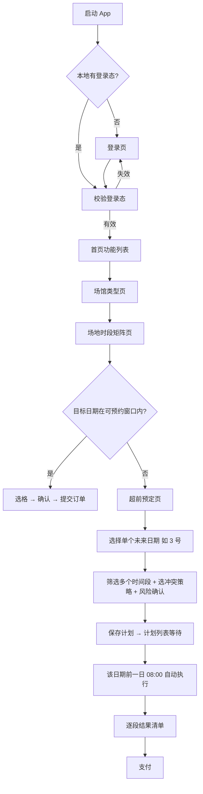

# Book · 开发方案

> 版本：v0.2（待评审）
> 状态：设计阶段，未开始编码
> 技术栈：Flutter（复用现有 Hunau App 的登录与 Cookie 能力）

---

## 1. 项目背景

学校体育场馆通过超星预约系统（`reserve.chaoxing.com`）开放线上预约。现有 Hunau App 只是用 WebView 加载该网页，用户需要逐级点选，看不到全场馆、全场地、全时段的全貌，也无法在开放瞬间抢约。

本项目是独立 App，目标是把场馆预约拆成两种使用方式：

1. **当场预约**：可预约窗口内，直接以表格查看所有场地与时段状态，点格下单。
2. **超前预定**：对尚未开放、状态不可见的日期，提前配置多时段与冲突策略，到开放时刻自动提交。

---

## 2. 范围

### 2.1 本期范围

| 能力 | 说明 |
| --- | --- |
| 登录 | 学校账号密码登录，CAS 换取超星 cookie，持久化 |
| 功能入口 | 首页功能卡片，当前含「场馆预约」 |
| 场馆类型 | 乒乓球馆、羽毛球馆等类型列表 |
| 场地矩阵 | 场馆内全部场地 × 全部时段的预约状态表格 |
| 当场预约 | 矩阵页内选时段并提交订单 |
| 超前预定 | 对单个未来日期预先选定多个时间段，并设定冲突策略 |
| 准点执行 | 开放时刻自动提交，按策略处理冲突 |
| 支付 | WebView 支付页，订单倒计时与状态轮询 |
| 日志 | 记录每个阶段时间戳与响应，便于复盘 |

### 2.2 非目标

- 多账号管理、账号池。
- 验证码破解、代理池、云端部署。
- 绕过学校预约规则。
- 高频并发刷单。

---

## 3. 用户流程

### 3.1 主流程



### 3.2 当场预约路径

```
场馆类型页 → 矩阵页 → 点选可约时段 → 确认弹窗 → 提交 → 支付
```

特点：目标日期已经开放，状态可见，冲突概率低，提交后立即进入支付。

### 3.3 超前预定路径

```
矩阵页 → 「超前预定」→ 选择单个未来日期（如 3 号）
      → 筛选多个时间段（可排序优先级）
      → 选择冲突处理策略 → 风险确认弹窗 → 保存计划
      → 计划列表等待 → 该日期前一日 08:00 自动执行 → 逐段结果 → 支付
```

特点：目标日期在可预约窗口之外，没有已预约信息；一个计划对应一个日期与多个时间段。

---

## 4. 业务规则

### 4.1 可预约窗口（08:00 至次日 08:00）

每日 08:00 释放「次日」。可预约日期 = 今日 + 明日。

| 窗口 | 可预约日期 | 说明 |
| --- | --- | --- |
| 1 号 08:00 – 2 号 08:00 | 1 号、2 号 | 3 号不可预约 |
| 2 号 08:00 – 3 号 08:00 | 2 号、3 号 | 4 号不可预约 |

客户端约束：

- 以 1 号为例：1 号 08:00 之后即可预约 1 号和 2 号，3 号不在窗口内。
- 矩阵页只展示窗口内日期的真实状态；窗口外日期不展示、不可提交。
- 已保存的超前计划在跨天后必须重新校验目标日期与执行时刻。

### 4.2 状态可见性

矩阵页的数据来自服务端的实时占用状态，但只能覆盖可预约窗口内的日期。超前预定执行时，服务端才会真正校验库存，因此：

- 用户看到的是"计划"，不是"已锁定"；
- 窗口外日期无法预知占用情况；
- 提交时可能遇到时段已被他人占用；
- 多时段提交可能部分成功、部分失败。

### 4.3 超前预定（单日期、多时间段）

- 一个计划只对应一个日期，计划内可包含多个时间段。
- 目标日期必须是窗口之外的未来日期，例如 1 号当天配置 3 号。
- 锁定仅表示保存计划，不代表已占位，也不保证成功。
- 执行时刻为该日期开放的前一日 08:00：3 号的计划在 2 号 08:00 执行。
- 不支持一次配置多个日期，不同日期需分别建立计划。

### 4.4 冲突与部分成功

- 执行结果必须逐段展示：成功 / 失败 / 未尝试。
- 失败原因要区分：已约满、未开放、登录失效、网络失败。
- 若服务端不支持取消，严格策略可能留下部分已成功订单，需在风险提示中说明。

---

## 5. 页面设计

### 5.1 登录页

- 字段：账号、密码。
- 按钮：登录（提交中禁用）。
- 错误提示：账号密码错误、网络错误、服务端异常。
- 登录成功后写入 cookie 并跳转首页。

### 5.2 首页

- 功能卡片列表，当前仅「场馆预约」。
- 可预留 F-09「场馆概览」卡片位置。

### 5.3 场馆类型页

- 内容：场馆类型列表（乒乓球馆、羽毛球馆等）。
- 每项展示：图标、名称、可约概况（如今日剩余时段数）。
- 点击进入该场馆的场地时段矩阵页。

### 5.4 场地时段矩阵页（重点）

#### 5.4.1 信息结构

- 纵向：该场馆下全部场地（一号场地、二号场地……）。
- 横向：该场馆的时段（粒度待确认，暂按服务端原始时段）。
- 单元格：某场地在某时段的预约状态。

进入页面即自动拉取该场馆、该日期的全量矩阵数据，用户无需逐项查询。

#### 5.4.2 布局

```
┌────────────────────────────────────────────────────┐
│ 羽毛球馆        [今天] [明天]              ⟳ 刷新   │
├──────────┬────────┬────────┬────────┬────────┬─────┤
│ 场地\时段 │ 09-10  │ 10-11  │ 11-12  │ 12-13  │ ... │
├──────────┼────────┼────────┼────────┼────────┼─────┤
│ 一号场地  │  可约  │  已约  │  可约  │  可约  │     │
│ 二号场地  │  已约  │  可约  │  已约  │  可约  │     │
│ 三号场地  │  可约  │  可约  │  可约  │  已约  │     │
│ ...      │        │        │        │        │     │
├──────────┴────────┴────────┴────────┴────────┴─────┤
│ 图例：■可约  ■已约  □未开放  ■已选                  │
└────────────────────────────────────────────────────┘
```

布局要求：

- **首列（场地名）与表头（时段）冻结**，横向/纵向滚动时保持可见。
- 首列宽度固定，时段列等宽。
- 底部固定图例与操作栏（选中后出现）。

#### 5.4.3 单元格状态

| 状态 | 视觉 | 可交互 |
| --- | --- | --- |
| 可约 | 主色/绿色填充，白字 | 可点选 |
| 已约 | 灰色填充，弱化文字 | 不可选，可查看详情 |
| 未开放 | 浅色虚线边框 | 不可选 |
| 已选 | 高亮描边 + 勾选图标 | 可取消 |
| 加载中 | 骨架/占位 | 不可交互 |
| 未知 | 问号或"数据缺失" | 不可选，可重试 |

可读性要求：不能只靠颜色区分状态，需同时有文字或图标，兼顾深浅色模式与色弱用户。

#### 5.4.4 交互

- 点击可约格子：选中/取消（默认单选，是否允许多选待定）。
- 长按格子：查看详情（场地、时段、价格）。
- 选中后底部出现操作栏：「已选 N 段」「查看已选」「预约」。
- 左右滑动切换日期，仅限可预约窗口内的日期。
- 下拉刷新重新拉取矩阵。
- 顶部导航栏提供「超前预定」按钮（位置与形式待定）。

#### 5.4.5 加载与异常

| 场景 | 处理 |
| --- | --- |
| 首次加载 | 骨架屏，标注"正在获取场地状态" |
| 局部失败 | 该场馆提示"数据加载失败，点击重试" |
| 登录失效 | 自动重登，仍失败则回登录页 |
| 空数据 | 显示"当前日期暂无可约场地" |
| 数据过期 | 提交前二次校验状态，若已被占用提示刷新 |

#### 5.4.6 性能

- 矩阵一次性拉取；若接口只支持按场地查询，则并发拉取并合并。
- 场地数 × 时段数较大时，行采用懒加载/虚拟滚动，避免一次性构建全部单元格。
- 切换日期时缓存上一次结果，减少重复请求。

#### 5.4.7 设计原则

1. **一屏可判**：用户不点进详情就能知道哪个场地哪个时段能约。
2. **操作最少**：从看到格子到提交不超过 2 次点击。
3. **状态诚实**：未开放就显示未开放，不用猜测颜色填充。
4. **刷新可信**：明确展示数据刷新时间，避免用户基于过期数据下单。

### 5.5 当场预约（操作形式待定）

候选方案：

| 方案 | 操作 | 优点 | 缺点 |
| --- | --- | --- | --- |
| A（推荐） | 点格子 → 底部确认弹窗（场地/时段/价格/人数）→ 提交 | 明确、误触少 | 多段预约较慢 |
| B | 多选格子 → 底部「预约 N 段」→ 批量提交 | 适合连续时段 | 依赖服务端支持批量 |
| C | 长按格子 → 直接下单 | 最快 | 易误触，需二次确认 |

提交成功后进入支付；失败按错误码提示（已约满则刷新矩阵）。

### 5.6 超前预定页

#### 5.6.1 步骤

1. 选择场馆（默认带入当前场馆）。
2. 选择目标日期：单个窗口外日期（如 3 号），标注「未开放，状态未知」。
3. 筛选时间段：支持多段，可拖拽调整优先级。
4. 选择冲突处理策略。
5. 风险确认 → 保存计划。

保存后进入计划列表，显示该计划的执行时刻（目标日前一日 08:00）。

#### 5.6.2 时段筛选

- 按时段列表多选，展示每段所属场地与优先级序号。
- 支持"同一时段多场地"作为并列项。
- 可为每段设置备选（场地/时段），供替补策略使用。
- 允许设置"仅保留前 N 段成功"的截断条件（可选）。

#### 5.6.3 冲突处理策略（候选，待定）

| 编号 | 策略 | 行为 | 适用 |
| --- | --- | --- | --- |
| C-1 | 全有或全无 | 任一段失败则整单放弃 | 时段必须成套使用 |
| C-2 | 尽力而为 | 按优先级依次提交，失败跳过，成功保留 | 能约几段算几段 |
| C-3 | 自动替补 | 失败段按同场地相邻时段 → 同时段其他场地 → 备选清单依次尝试 | 接受时间/场地微调 |
| C-4 | 备选清单 | 仅在用户预设的备选里替补 | 对场地有硬性要求 |
| C-5 | 只保首段 | 只保证优先级第一段，其余不自动尝试 | 目标单一 |

说明：

- C-1 若服务端无取消接口，已成功的段可能无法撤销，需在确认页明确提示。
- C-3 的替补顺序必须在计划保存时展示给用户确认。

#### 5.6.4 风险确认

保存计划时弹出确认：

> 目标日期为 3 号，尚未开放，无法预知所选时段是否已被占用。
> 执行时可能出现部分或全部失败，计划将在 2 号 08:00 执行。
> 当前策略：尽力而为（失败段跳过）。
> 是否继续？

用户确认后才允许保存计划。

#### 5.6.5 计划确认

展示内容：场馆、目标日期、时间段与优先级、冲突策略、执行时刻、提前量、重试次数。

#### 5.6.6 计划列表

- 按目标日期排序展示所有已保存的计划。
- 每项显示：日期、时间段数量、策略、执行时刻、启用状态。
- 支持启用/停用、编辑、删除、手动立即执行。
- 到期前 24 小时与 1 小时各给出一次提醒（需要通知权限）。

### 5.7 执行页

展示：

- 距离开放时刻倒计时。
- 登录态、时钟偏差、连接预热状态。
- 逐段执行结果：成功（订单号）/ 失败（原因）/ 未尝试。
- 操作：取消计划、手动执行、去支付、重新配置。

### 5.8 支付页

- 从订单响应或订单详情取支付地址。
- WebView 打开，UA 与预约页一致。
- 订单倒计时（以服务端到期时间为准）。
- 轮询订单状态，上限与倒计时一致；超时标记过期并允许重新预约。

### 5.9 历史页

- 计划列表与执行日志。
- 查看逐段结果、订单号、失败原因。
- 支持复制订单号。

---

## 6. 技术架构

### 6.1 分层

```
presentation   页面 / 组件 / 状态
application    用例：登录、矩阵查询、当场预约、超前计划、执行
domain         模型：VenueType / Court / Slot / Plan / Result / Order
infrastructure 网络(Dio + CookieJar)、存储、WebView、时间同步
```

### 6.2 复用现有代码

| 能力 | 复用来源（现有 Hunau App） |
| --- | --- |
| CAS/超星登录 | `lib/features/auth/services/http_login_service.dart` |
| 登录态读取 | `lib/features/auth/providers/auth_provider.dart` |
| Cookie 持久化与 WebView 同步 | `lib/core/network/cookie_manager.dart` |
| WebView 容器 | `lib/features/workspace/screens/webview_detail_screen.dart` |
| 场馆入口地址与参数 | `lib/core/constants/app_constants.dart` |

复用方式为"拷贝模块 + 裁剪依赖"，保持新工程独立可编译。

### 6.3 关键依赖

- `dio`、`cookie_jar`、`dio_cookie_manager`
- `flutter_inappwebview`
- `flutter_secure_storage`、`shared_preferences`
- `intl`（时间格式化）

---

## 7. 模块设计

### 7.1 AuthService

- `login(username, password)`：CAS 登录，产出 cookie。
- `ensureSession()`：轻量接口校验，302/401 视为失效。
- `logout()`：清理 passport2 / reserve cookie。
- 登录态落盘，冷启动恢复。

### 7.2 VenueService

| 方法 | 作用 |
| --- | --- |
| `getVenueTypes()` | 场馆类型列表 |
| `getCourts(venueTypeId)` | 场地列表 |
| `getSlotMatrix(venueTypeId, date)` | 全场地 × 全时段状态 |
| `submit({courtId, slot, date, people})` | 提交单段预约 |
| `getOrders()` / `getOrder(orderId)` | 订单查询 |

要求：与鉴权共用 `CookieJar`；复用单个 `Dio` 实例保持 keep-alive；记录 `t0/t1/响应码/业务码`。

### 7.3 TimeSyncService

```text
对同一轻量接口采样 N=5 次：
  t0 = 单调时钟起点
  t1 = 单调时钟终点
  serverTime = 响应头 Date（秒级）
  offset_i = serverTime + (t1 - t0)/2 - localNow
取中位数作为最终偏移量
```

- 有毫秒时间戳时优先使用。
- 定时全部基于 `Stopwatch`，不受系统时间变更影响。
- 每次执行前重新校准。

### 7.4 ReservationScheduler

状态机：

```text
idle → prewarm → armed → firing → executing → submitted → paying → finished
                                        ↘ failed
```

| 状态 | 动作 |
| --- | --- |
| prewarm | 校验登录态、预取矩阵/时段 id、构造 payload、预热连接 |
| armed | 计算触发时刻，启动高精度定时 |
| firing | 发出第一段提交 |
| executing | 按冲突策略逐段执行，记录结果 |
| submitted | 汇总结果，跳转支付或展示失败清单 |
| paying | 支付页 + 状态轮询 |
| failed | 全段失败或登录失效，给出原因 |

计划队列：调度器维护按执行时刻排序的计划队列，每个计划独立走一次状态机；跨天时重新加载计划并刷新目标日期。

### 7.5 ConflictResolver

职责：在多段提交过程中执行冲突策略。

```text
按优先级遍历计划时段:
  result = submit(slot)
  if 成功: 记录订单
  else:
    C-1: 标记整体失败，停止，提示已成功段需人工处理
    C-2: 记录失败，继续下一段
    C-3: 依次尝试替补（相邻时段 → 同时段其他场地 → 备选清单）
    C-4: 仅尝试用户备选
    C-5: 首段结束后停止
最后输出逐段结果
```

注意：策略执行期间不再发起查询类请求，避免干扰提交时序。

### 7.6 PaymentService

- 取支付地址，WebView 打开。
- 订单倒计时与轮询，超时收口。
- 支持多订单时逐单展示支付入口。

---

## 8. 准点执行时序

| 时刻 | 动作 | 备注 |
| --- | --- | --- |
| 任意时间 | 登录、选择单个未来日期、保存计划 | 提前数天即可配置 |
| 07:59:50 | 登录态校验 + 预取场地/时段 id | 失败则立即重登 |
| 07:59:55 | 连接预热 | 完成 DNS、TLS、keep-alive |
| 07:59:58 | 时钟校准、最终 payload、启动定时 | payload 不再变化 |
| 08:00:00 - ahead | 发出第一段 POST | ahead 默认 150ms |
| 失败后 +150ms | 按冲突策略执行后续段 | 最多 5 次/段 |
| 结束 | 汇总结果 → 支付或失败清单 | 立即 |

定时实现：距目标 > 1s 用普通 `Timer`；最后 200ms 用 `Stopwatch` 循环检测；触发前不发查询请求。

每个计划在其目标日期的前一日 08:00 重复上述流程：3 号的计划在 2 号 08:00 执行。

---

## 9. 数据模型

```dart
class VenueType {
  final String id;
  final String name;
  final String icon;
}

class Court {
  final String id;
  final String venueTypeId;
  final String name;          // 一号场地
}

enum SlotStatus { available, booked, unopened, unknown }

class Slot {
  final String id;
  final String courtId;
  final String date;
  final String startTime;
  final String endTime;
  final SlotStatus status;
  final int price;
}

class SlotMatrix {
  final String venueTypeId;
  final String date;
  final List<Court> courts;
  final List<String> timeColumns;
  final List<Slot> slots;
  final DateTime fetchedAt;
}

enum ConflictPolicy { allOrNothing, bestEffort, autoSubstitute, backupOnly, firstOnly }

class PlannedSlot {
  final String courtId;
  final String slotId;
  final int priority;               // 越小越优先
  final List<PlannedSlot> backups;
}

class AdvancePlan {
  final String planId;
  final String venueTypeId;
  final DateTime targetDate;        // 单个窗口外日期，如 3 号
  final DateTime executeAt;         // 目标日前一日 08:00
  final List<PlannedSlot> slots;
  final ConflictPolicy policy;
  final int aheadMs;                // 默认 150
  final int maxRetry;               // 默认 5
  final int retryIntervalMs;        // 默认 200
  final bool enabled;
}

enum SegmentResult { success, failed, skipped, notTried }

class ExecutionResult {
  final PlannedSlot slot;
  final SegmentResult result;
  final String? orderId;
  final String? failReason;
  final int costMs;
}

class Order {
  final String orderId;
  final String status;              // pending / paid / cancelled / expired
  final String payUrl;
  final DateTime createdAt;
  final DateTime expireAt;
}
```

---

## 10. 接口清单（待确认）

> 需在实机/浏览器抓包后补全，当前为占位。

| 用途 | 方法 | 路径 | 关键参数 | 状态 |
| --- | --- | --- | --- | --- |
| 登录入口 | GET | `cas.hunau.edu.cn/cas/login` | service、execution、lt | 已复用 |
| 超星登录态 | GET | `passport2.chaoxing.com` | 参考现有实现 | 已复用 |
| 预约首页 | GET | `reserve.chaoxing.com/front/web/apps/reservepc/index` | `reserveId=14191`、`fidEnc` | 已确认存在 |
| 场馆类型列表 | ? | 待抓包 | - | 待确认 |
| 场地列表 | ? | 待抓包 | `venueTypeId` | 待确认 |
| 时段矩阵 | ? | 待抓包 | `venueTypeId`、`date` | 待确认 |
| 提交预约 | ? | 待抓包 | 场地/时段/日期/人数 | 待确认 |
| 订单列表 | ? | 待抓包 | - | 待确认 |
| 支付入口 | ? | 待抓包 | `orderId` | 待确认 |

### 必须确认的问题

1. 矩阵接口能否一次返回全部场地 × 全部时段？还是需要按场地分别请求？
2. 未开放日期的场地/时段 id 能否提前获取？
3. 提交接口是否支持一次多段？还是一个时段一张订单？
4. 是否含动态签名、一次性 token 或验证码？
5. 冲突失败时服务端返回的错误码/文案是什么？
6. 支付地址从哪个接口获取，能否在独立 WebView 打开？
7. 同账号是否存在请求频率限制？

---

## 11. 错误处理矩阵

| 场景 | 判定 | 处理 |
| --- | --- | --- |
| 登录态失效 | 302 / 401 | 静默重登 1 次，失败回登录页 |
| 未到开放时间 | 业务码/文案 | 退后 50～100ms 重试 |
| 时段已约满 | 业务码/文案 | 按冲突策略：跳过 / 替补 / 放弃 |
| 请求超时/5xx | 网络层 | 150ms 后重试，最多 5 次 |
| 重复提交 | 提交前查订单 | 已有订单则不再提交 |
| 矩阵数据过期 | 提交前二次校验 | 提示刷新，不静默替换 |
| 支付超时 | 订单到期时间 | 停止轮询，标记过期 |

---

## 12. 安全与合规

- 账号密码仅存本地安全存储，不上传第三方服务。
- 不采集学号等可识别信息用于其他用途。
- 不做多账号并发、不绕过验证码。
- 日志仅本地保存，默认不含明文密码。
- 请求频率贴近人工操作，避免风控与账号处罚。

---

## 13. 风险

| 风险 | 影响 | 应对 |
| --- | --- | --- |
| 矩阵接口按场地拆分 | 首屏加载慢 | 并发拉取 + 合并 + 本地缓存 |
| 提交接口有动态签名 | 纯 HTTP 不可行 | 回退 WebView 注入同源 fetch |
| 多段部分失败 | 用户预期落差 | 风险确认 + 逐段结果 + 策略可选 |
| 服务端无取消接口 | 严格策略留下零散订单 | 确认页明确提示 |
| 08:00 限流 | 首包被拒 | 低频重试 + 备选时段 |
| cookie 生命周期短 | 8 点前失效 | 开放前 10 秒校验并重登 |
| 支付页限制 UA/referer | 支付失败 | 固定 UA；必要时外部浏览器 |
| 计划的后台执行 | App 被系统杀死导致漏跑 | 精确闹钟 + 前台服务/通知提醒，启动时补偿状态 |
| 跨天计划日期漂移 | 执行到错误日期 | 每次执行前按 08:00 规则重算并校验目标日期 |

---

## 14. 开发阶段

| 阶段 | 内容 | 验收 |
| --- | --- | --- |
| M0 验证 | 抓包确认矩阵、提交、多段、冲突错误码 | 形成接口文档，可手动复现一次成功预约 |
| M1 骨架 | 初始化工程、路由、主题 | 可启动、可跳转 |
| M2 登录 | 移植登录与 cookie 模块 | 登录成功，重启保持登录态 |
| M3 场馆与矩阵 | 场馆类型页 + 矩阵页 | 数据与网页一致，表头冻结，可刷新 |
| M4 当场预约 | 选格、确认、提交、支付 | 完成一次端到端预约 |
| M5 超前预定 | 单日期多时段筛选、策略、风险确认、计划列表 | 计划可保存、回显并启停 |
| M6 准点执行 | 时钟同步 + 调度器 + 冲突策略执行 | 首包偏差 ≤ 200ms，逐段结果准确 |
| M7 支付完善 | 多订单支付、倒计时、轮询 | 超时收口正确 |
| M8 打磨 | 日志、历史、异常提示 | 全流程可复盘 |

> M0 未通过前，不进入 M6 编码。

---

## 15. 验收标准

1. 冷启动登录成功率 ≥ 95%（网络正常）。
2. 矩阵页数据与网页端一致，刷新时间可见。
3. 从看到可约格子到提交完成不超过 2 次点击。
4. 时钟校准后与服务端偏差 ≤ 50ms。
5. 开放时刻首包发出偏差 ≤ 200ms。
6. 多段执行结果逐段准确展示，失败原因可区分。
7. 成功订单可在 App 内完成支付，超时能正确收口。
8. 每次执行均有完整日志（时间戳、请求、响应码、耗时）。

---

## 16. 待评审确认项

- [ ] 矩阵页时段粒度（整点 / 30 分钟 / 服务端原始粒度）。
- [ ] 矩阵页是否允许多选（当场预约走方案 A 还是 B）。
- [ ] 「超前预定」按钮放在矩阵页导航栏的具体形式。
- [ ] 超前预定可选的目标日期范围（窗口外的哪些日期允许配置）。
- [ ] 计划的后台执行方式（前台驻留 / 精确闹钟 / 前台服务）。
- [ ] 冲突策略最终选项（C-1 ～ C-5 是否全部保留）。
- [ ] 服务端是否支持一次多段提交。
- [ ] 服务端是否支持取消订单（影响 C-1 可行性）。
- [ ] 未开放日期能否提前拿到场地/时段 id。
- [ ] 支付页是否允许外部浏览器打开。
- [ ] F-09「场馆概览」是否需要本期实现。
